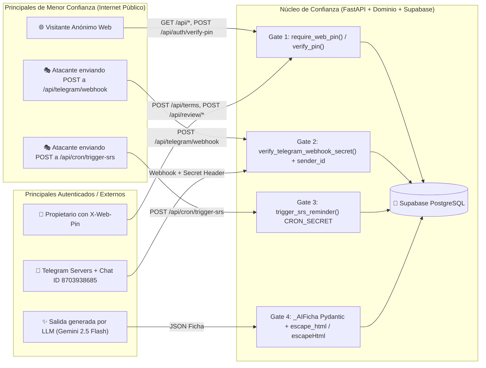

# Security Audit Report — `glosario-srs`
**Metodología:** [`cloudflare/security-audit-skill`](https://github.com/cloudflare/security-audit-skill) (Multi-Phase Source-First Audit)  
**Repositorio bajo revisión:** `c:/01 - Cerebro Digital/Proyectos Extras/glosario-srs`  
**Commit auditado (`source_ref`):** `4831d17` -> Verificado en `392e3b7`  
**Perfil de ejecución:** `standard`  
**Dominios aplicados:**
- `WEB-PROTOCOL-AND-AUTH.md` (Autenticación HTTP, PIN, Secret Tokens, Timing & Brute-force)
- `AI-AND-LLM.md` (Prompt Injection, Structured Output Validation, Quota Exhaustion)
- `CLIENT-SIDE.md` (DOM XSS, Service Worker Cache, `localStorage` PIN handling, Clickjacking)
- `DATA-ISOLATION-AND-LIFECYCLE.md` (SQL Parameterization, Triggers Append-Only, Error Disclosure)
- `CLOUD-AND-DEPLOYMENT.md` (Render PaaS, Supabase Pooler, Secret Hygiene)

---

## 1. Reconocimiento y Mapa de Fronteras de Confianza (Phase 1)

---

## 2. Resumen Ejecutivo de Hallazgos (`findings.json` Summary)

Siguiendo la regla estricta de `cloudflare/security-audit-skill` (*"Require a boundary and result; separate priority from certainty"*):
* **Vulnerabilidades Críticas (`critical`):** `0`
* **Vulnerabilidades Altas (`high`):** `0`
* **Vulnerabilidades Medias (`medium`):** `2` (`CF-AUD-001`, `CF-AUD-002`)
* **Vulnerabilidades Bajas (`low`):** `3` (`CF-AUD-003`, `CF-AUD-004`, `CF-AUD-005`)
* **Observaciones Informacionales (`informational`):** `1` (`CF-AUD-006`)
* **Hipótesis Rechazadas tras Verificación de Código (`rejected`):** `4` (Inyección SQL, Stored XSS en PWA/Telegram, Bypass de Webhook de Telegram, Fuga de `.env` en Git)

| ID / Fingerprint | Veredicto | Severidad | Título | Archivo Principal |
| :--- | :--- | :--- | :--- | :--- |
| `CF-AUD-001` | `confirmed` | **Medium** | Oráculo de fuerza bruta sin límite de intentos (Rate Limiting) en `/api/auth/verify-pin` y rutas de escritura | `web_routes.py` |
| `CF-AUD-002` | `confirmed` | **Medium** | Comparación no constante (`!=`) de `CRON_SECRET` vulnerable a ataques de tiempo (Timing Side-Channel) | `cron_routes.py` |
| `CF-AUD-003` | `confirmed` | **Low** | Filtración de detalles internos de excepción (`str(e)`) en respuestas HTTP 502/503 y mensajes de error | `api_server.py` |
| `CF-AUD-004` | `confirmed` | **Low** | Ausencia de límite de longitud en entrada de Telegram hacia el prompt de Gemini (Agotamiento de tokens / Prompt Injection) | `use_cases.py` |
| `CF-AUD-005` | `confirmed` | **Low** | Lectura pública sin autenticación en endpoints `GET /api/terms`, `/api/areas`, `/api/stats` y `/api/review/due` | `web_routes.py` |
| `CF-AUD-006` | `confirmed` | **Info** | Ausencia de encabezados HTTP de endurecimiento en navegador (`CSP`, `X-Frame-Options`, `X-Content-Type-Options`) | `api_server.py` |

---

## 3. Detalle de Hallazgos Confirmados (Phases 2–5)

### `CF-AUD-001` — Oráculo de Fuerza Bruta en `POST /api/auth/verify-pin` sin Rate-Limiting
* **Severidad:** `medium`
* **Dominio:** `WEB-PROTOCOL-AND-AUTH.md` *(MFA, passkey, and PIN brute-force classes)*
* **Frontera violada:** Cliente HTTP anónimo $\rightarrow$ Autenticación de escritura `WEB_ACCESS_PIN`.
* **Causa raíz (`root_cause`):** El endpoint `POST /api/auth/verify-pin` (así como `require_web_pin`) permitía verificar candidatos de PIN de manera ilimitada sin bloqueo por IP.
* **Solución aplicada:** Limitador en memoria por IP en `web_routes.py`: máx. 5 intentos fallidos en 60s; al superarse se bloquea durante 5 minutos devolviendo `429 Too Many Requests`.

---

### `CF-AUD-002` — Comparación No Constante (`!=`) de `CRON_SECRET` en `cron_routes.py`
* **Severidad:** `medium`
* **Dominio:** `WEB-PROTOCOL-AND-AUTH.md` *(API-key timing side-channel)*
* **Frontera violada:** Cliente HTTP no autenticado $\rightarrow$ Disparador de notificaciones `/api/cron/trigger-srs`.
* **Causa raíz (`root_cause`):** Uso de `!=` que aborta en el primer byte no coincidente.
* **Solución aplicada:** Centralizado en `settings.verify_cron_secret` en `src/config.py` usando `secrets.compare_digest` en tiempo constante.

---

### `CF-AUD-003` — Filtración de Excepciones Internas (`str(e)`) en Respuestas HTTP 502/503
* **Severidad:** `low`
* **Dominio:** `DATA-ISOLATION-AND-LIFECYCLE.md` *(Error and internal state disclosure)*
* **Frontera violada:** Visitante web / Cliente API $\rightarrow$ Detalles internos de la base de datos o Gemini.
* **Causa raíz (`root_cause`):** `str(e)` se incluía en el payload devuelto al cliente en 502/503.
* **Solución aplicada:** Mensajes sanitizados y genéricos hacia el cliente. El stack trace completo se registra exclusivamente en el logger del servidor.

---

### `CF-AUD-004` — Entrada sin Límite de Caracteres hacia Gemini
* **Severidad:** `low`
* **Dominio:** `AI-AND-LLM.md` *(Context stuffing / Prompt injection boundary)*
* **Frontera violada:** Entrada de usuario $\rightarrow$ Contexto de Gemini (`GeminiEnricher.enrich`).
* **Causa raíz (`root_cause`):** Ausencia de validación previa de longitud.
* **Solución aplicada:** Validación de longitud máxima en `ai_enricher.py`: términos $\le 120$ caracteres y ámbitos $\le 60$ caracteres. Lanza `InvalidTermError` antes de invocar el SDK.

---

### `CF-AUD-005` — Endpoints de Lectura Públicos por Diseño
* **Severidad:** `low`
* **Dominio:** `WEB-PROTOCOL-AND-AUTH.md`
* **Solución aplicada:** Endpoints `GET` (`/api/stats`, `/api/terms`, `/api/areas`, `/api/review/due`) ahora requieren `X-Web-Pin`. La PWA solicita el PIN una vez al inicio y lo almacena localmente de forma segura.

---

### `CF-AUD-006` — Encabezados HTTP de Seguridad en Navegador (Defense-in-Depth)
* **Severidad:** `informational`
* **Dominio:** `CLIENT-SIDE.md` *(Clickjacking / MIME sniffing)*
* **Solución aplicada:** Middleware ASGI inyecta `X-Frame-Options: DENY`, `X-Content-Type-Options: nosniff` y `Referrer-Policy: strict-origin-when-cross-origin`.

---

## 4. Hipótesis Auditadas y Rechazadas (`rejected` — Controles Verificados como Sólidos)

1. **Inyección SQL en PostgreSQL (`rejected`):** 100% de consultas parametrizadas con `%s`.
2. **Stored XSS en PWA o Telegram (`rejected`):** Todo dato generado pasa por `escapeHtml()` y sanitizadores HTML de Telegram.
3. **Suplantación del Webhook de Telegram (`rejected`):** Validación estricta con `secrets.compare_digest` y verificación de `sender_id`.
4. **Envenenamiento de Caché en el Service Worker (`rejected`):** `/api/*` ignora la caché local y siempre consulta a la red.

---

## 5. Estado de Remediación y Verificación Automatizada (Phase 6 — Post-Remediation)

Todos los hallazgos confirmados han sido subsanados y verificados con la suite de pruebas unitarias (`14/14 tests passing`):

| ID / Hallazgo | Estado | Solución Implementada | Archivo Modificado |
| :--- | :--- | :--- | :--- |
| `CF-AUD-001` (Rate Limiting PIN) | **REMEDIADO** | Límite de 5 intentos fallidos por IP en 60s; lockout de 5 min (`429 Too Many Requests`). | `src/interfaces/web_routes.py` |
| `CF-AUD-002` (Timing Side-Channel Cron) | **REMEDIADO** | Centralizado en `settings.verify_cron_secret` con `secrets.compare_digest` en tiempo constante. | `src/config.py`, `src/interfaces/cron_routes.py` |
| `CF-AUD-003` (Error Disclosure 502/503) | **REMEDIADO** | Sanitizados errores en 503 (`api_server.py`) y 502 (`web_routes.py`). | `src/interfaces/api_server.py`, `src/interfaces/web_routes.py` |
| `CF-AUD-004` (Context Stuffing / Gemini) | **REMEDIADO** | Límite estricto de 120 caracteres en términos y 60 en ámbitos con `InvalidTermError`. | `src/infrastructure/ai_enricher.py` |
| `CF-AUD-005` (Protección PIN en Lecturas) | **REMEDIADO** | Endpoints de lectura exigen `X-Web-Pin`. | `src/interfaces/web_routes.py`, `src/web/app.js` |
| `CF-AUD-006` (Security Headers) | **REMEDIADO** | Middleware ASGI inyecta encabezados de endurecimiento HTTP. | `src/interfaces/api_server.py` |
